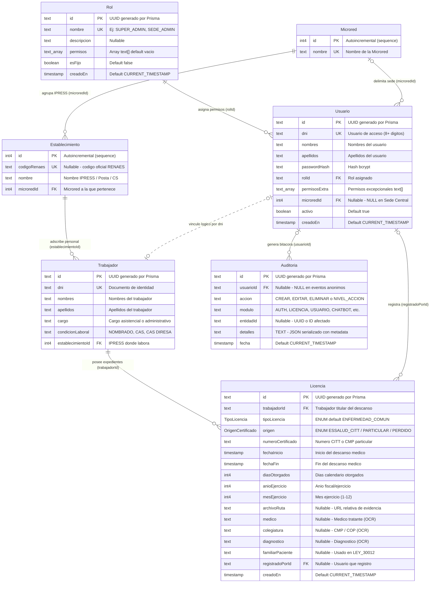
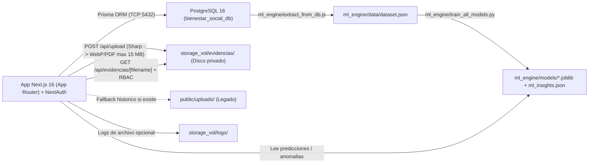

# Arquitectura y Diagrama Completo de Base de Datos — Bienestar Social Salud

> **Propósito del documento:** Referencia técnica completa de la base de datos y almacenamiento persistente del sistema **Bienestar Social Salud (Red de Salud Huánuco)**, preparada para planificar y ejecutar el **traslado / migración de infraestructura** o consultar el modelo de datos.

---

## 1. Resumen Ejecutivo Técnico

| Parámetro | Valor verificado en el sistema |
| :--- | :--- |
| **Motor de Base de Datos** | `PostgreSQL 16.15` (contenedor Docker `postgres:16-alpine`, servicio `bienestar_db`) |
| **Nombre de la BD / Esquema** | `bienestar_social_db` · Esquema `public` |
| **Tamaño base de referencia** | **8,791 kB (~8.8 MB)** (corte noviembre 2026) |
| **ORM y Definición de Esquema** | Prisma `^5.22.0` (`@prisma/client`) — fuente única en [`prisma/schema.prisma`](../../../../prisma/schema.prisma) |
| **Estrategia de Esquema** | Sin carpeta `prisma/migrations/`; el esquema se sincroniza con `npx prisma db push` |
| **Objetos en `public`** | **7 tablas base**, **2 tipos ENUM**, **0 vistas**, **12 índices únicos** (7 PK + 5 UNIQUE) |
| **Volumen de referencia** | **2,118 filas** distribuidas en las 7 tablas |
| **Almacenamiento fuera de BD** | Evidencias en `storage_vol/evidencias/` (y rutas heredadas `/uploads/`), logs en `storage_vol/logs/` y modelos/datos ML en `ml_engine/` |

---

## 2. Diagrama Entidad–Relación (ERD) Completo

- **Líneas sólidas (`--`)**: Claves foráneas reales impuestas por PostgreSQL.
- **Línea punteada (`..`)**: Vínculo lógico a nivel de aplicación entre `Usuario.dni` y `Trabajador.dni` para el portal de autogestión del trabajador.
- *Nota de sintaxis:* `text_array` representa el tipo nativo de PostgreSQL `text[]` (`_text`).

---

## 3. Arquitectura de Datos y Almacenamiento Híbrido (Lo que debe trasladarse)

La base de datos PostgreSQL **no almacena archivos binarios (`BYTEA`) ni modelos analíticos**. Para un traslado íntegro del sistema, el ingeniero debe considerar cuatro piezas acopladas:

---

## 4. Tipos ENUM Definidos en PostgreSQL

### 4.1 `TipoLicencia`
| Valor ENUM | Uso funcional en el sistema | Conteo de referencia en `Licencia` |
| :--- | :--- | :---: |
| `ENFERMEDAD_COMUN` | Descanso médico regular (valor por defecto). Incluye descansos largos sin mención literal de maternidad/paternidad. En reportes se agrupa bajo **"SALUD"**. | **245** |
| `ACCIDENTE_COMUN` | Accidente común o laboral. En reportes y Excel se agrupa junto con `ENFERMEDAD_COMUN` bajo **"SALUD"**. | **9** |
| `MATERNIDAD` | Licencia pre/post natal (98 días subsidiados al 100% por EsSalud). | **2** |
| `PATERNIDAD` | Licencia por paternidad (Ley 30807 — 10 días calendario). | **0** |
| `LEY_30012` | Licencia por enfermedad grave/terminal o accidente grave de familiar directo (hasta 7 días; usa `familiarPaciente`). | **0** |

### 4.2 `OrigenCertificado`
| Valor ENUM | Significado administrativo | Conteo de referencia en `Licencia` |
| :--- | :--- | :---: |
| `ESSALUD_CITT` | Certificado de Incapacidad Temporal para el Trabajo emitido por EsSalud. | **162** |
| `PARTICULAR` | Certificado médico particular sujeto a regla de **canje ante EsSalud en 30 días** (Semáforo de Canjes). | **94** |
| `PARTICULAR_PERDIDO` | Certificado particular cuyo plazo de canje venció o fue marcado perdido (excluido en algunos agregados ML). | **0** |

---

## 5. Diccionario Completo de Tablas

### 5.1 Tabla `"Rol"` (5 filas de referencia)
Catálogo de roles y permisos base para control de acceso (RBAC).

| Columna | Tipo PostgreSQL / Prisma | Nulo | Default | Restricciones | Descripción |
| :--- | :--- | :---: | :--- | :--- | :--- |
| `id` | `text` / `String @id` | NO | UUID (`@default(uuid())`) | **PK** (`Rol_pkey`) | Identificador único del rol. |
| `nombre` | `text` / `String` | NO | — | **UNIQUE** (`Rol_nombre_key`) | Código del rol. |
| `descripcion` | `text` / `String?` | SÍ | `NULL` | — | Descripción legible del rol. |
| `permisos` | `text[]` (`_text`) / `String[]` | SÍ* | `ARRAY[]::text[]` | — | Lista de códigos de permiso (`PERMISOS`). |
| `esFijo` | `boolean` / `Boolean` | NO | `false` | — | Protege roles de sistema contra eliminación. |
| `creadoEn` | `timestamp(3)` / `DateTime` | NO | `CURRENT_TIMESTAMP` | — | Fecha de creación. |

*\*Nota ORM: En `schema.prisma` es `String[] @default([])`; Prisma genera la columna `ARRAY` como nullable con default vacío en PostgreSQL.*

**Roles base del sistema:**
- `SUPER_ADMIN` (`esFijo: true`, `permisos: []`): bypass total de permisos y acceso multi-microred en [`rbac.ts`](../../../../src/core/auth/rbac.ts).
- `SEDE_ADMIN` (`esFijo: true`, 7 permisos): `VER_TRABAJADORES`, `VER_LICENCIAS`, `GESTIONAR_LICENCIAS`, `SUBIR_ARCHIVOS`, `SUBIR_CITT`, `EDITAR_TRABAJADORES`, `USAR_CHATBOT`.
- `VISUALIZADOR` (`esFijo: true`, 4 permisos): `VER_TRABAJADORES`, `VER_LICENCIAS`, `VER_REPORTES`, `VER_ARCHIVO_HISTORICO`.
- `TRABAJADOR` (`esFijo: true`, `permisos: []`): acceso exclusivo de autogestión (consulta sus propias licencias y usa BienestarBot).
- `JEFE_DE_RECURSOS_HUMANOS` (`esFijo: false`, 5 permisos): `VER_REPORTES`, `ADMINISTRAR_USUARIOS`, `VER_TRABAJADORES`, `EDITAR_TRABAJADORES`, `EXPORTAR_EXCEL_PERSONAL`.

---

### 5.2 Tabla `"Usuario"` (11 filas de referencia)
Cuentas de inicio de sesión (`NextAuth` con `CredentialsProvider`, autenticación por `dni` + contraseña `bcrypt`).

| Columna | Tipo PostgreSQL / Prisma | Nulo | Default | Restricciones / FK | Descripción |
| :--- | :--- | :---: | :--- | :--- | :--- |
| `id` | `text` / `String @id` | NO | UUID (`@default(uuid())`) | **PK** (`Usuario_pkey`) | ID único de cuenta. |
| `dni` | `text` / `String` | NO | — | **UNIQUE** (`Usuario_dni_key`) | Credencial de acceso y enlace lógico con `Trabajador.dni`. |
| `nombres` | `text` / `String` | NO | — | — | Nombres del usuario. |
| `apellidos` | `text` / `String` | NO | — | — | Apellidos del usuario. |
| `passwordHash` | `text` / `String` | NO | — | — | Hash `bcrypt` (prefijo `` `$2a$` `` / `` `$2b$` ``). |
| `rolId` | `text` / `String` | NO | — | **FK** -> `Rol(id)` (`ON UPDATE CASCADE ON DELETE RESTRICT`) | Rol principal asignado. |
| `permisosExtra` | `text[]` (`_text`) / `String[]` | SÍ* | `ARRAY[]::text[]` | — | Permisos adicionales sumados al rol en sesión. |
| `microredId` | `int4` / `Int?` | SÍ | `NULL` | **FK** -> `Microred(id)` (`ON UPDATE CASCADE ON DELETE SET NULL`) | Jurisdicción territorial del usuario (`NULL` para Sede Central / `SUPER_ADMIN` / `TRABAJADOR`). |
| `activo` | `boolean` / `Boolean` | NO | `true` | — | Controla revocación inmediata en [`getAuthContext`](../../../../src/core/auth/rbac.ts#L22-L67). |
| `creadoEn` | `timestamp(3)` / `DateTime` | NO | `CURRENT_TIMESTAMP` | — | Fecha de alta. |

---

### 5.3 Tabla `"Microred"` (28 filas de referencia)
Catálogo de jurisdicciones territoriales de la Red de Salud Huánuco.

| Columna | Tipo PostgreSQL / Prisma | Nulo | Default | Restricciones | Descripción |
| :--- | :--- | :---: | :--- | :--- | :--- |
| `id` | `int4` / `Int @id` | NO | `nextval('"Microred_id_seq"'::regclass)` | **PK** (`Microred_pkey`) | Identificador numérico secuencial. |
| `nombre` | `text` / `String` | NO | — | **UNIQUE** (`Microred_nombre_key`) | Nombre oficial de la Microred. |

---

### 5.4 Tabla `"Establecimiento"` (85 filas de referencia)
Catálogo de IPRESS (Centros y Puestos de Salud) pertenecientes a cada Microred.

| Columna | Tipo PostgreSQL / Prisma | Nulo | Default | Restricciones / FK | Descripción |
| :--- | :--- | :---: | :--- | :--- | :--- |
| `id` | `int4` / `Int @id` | NO | `nextval('"Establecimiento_id_seq"'::regclass)` | **PK** (`Establecimiento_pkey`) | Identificador numérico secuencial. |
| `codigoRenaes` | `text` / `String?` | SÍ | `NULL` | **UNIQUE** (`Establecimiento_codigoRenaes_key`) | Código oficial RENAES. |
| `nombre` | `text` / `String` | NO | — | — | Nombre del establecimiento. |
| `microredId` | `int4` / `Int` | NO | — | **FK** -> `Microred(id)` (`ON UPDATE CASCADE ON DELETE RESTRICT`) | Microred a la que reporta. |

---

### 5.5 Tabla `"Trabajador"` (1,620 filas de referencia)
Padrón nominal del personal asistencial y administrativo de la Red de Salud.

| Columna | Tipo PostgreSQL / Prisma | Nulo | Default | Restricciones / FK | Descripción |
| :--- | :--- | :---: | :--- | :--- | :--- |
| `id` | `text` / `String @id` | NO | UUID (`@default(uuid())`) | **PK** (`Trabajador_pkey`) | Identificador interno del trabajador. |
| `dni` | `text` / `String` | NO | — | **UNIQUE** (`Trabajador_dni_key`) | DNI único del trabajador. |
| `nombres` | `text` / `String` | NO | — | — | Nombres completos. |
| `apellidos` | `text` / `String` | NO | — | — | Apellidos completos. |
| `cargo` | `text` / `String` | NO | — | — | Cargo funcional / grupo ocupacional. |
| `condicionLaboral` | `text` / `String` | NO | — | — | Régimen laboral (`NOMBRADO`: 959, `CAS`: 624, `CAS DIRESA`: 37). |
| `establecimientoId` | `int4` / `Int` | NO | — | **FK** -> `Establecimiento(id)` (`ON UPDATE CASCADE ON DELETE RESTRICT`) | Establecimiento actual donde labora. |

---

### 5.6 Tabla `"Licencia"` (256 filas de referencia)
Tabla transaccional central del negocio: almacena certificados médicos (CITT y particulares), maternidad, paternidad y Ley 30012.

| Columna | Tipo PostgreSQL / Prisma | Nulo | Default | Restricciones / FK | Descripción |
| :--- | :--- | :---: | :--- | :--- | :--- |
| `id` | `text` / `String @id` | NO | UUID (`@default(uuid())`) | **PK** (`Licencia_pkey`) | ID del expediente / licencia. |
| `trabajadorId` | `text` / `String` | NO | — | **FK** -> `Trabajador(id)` (`ON UPDATE CASCADE ON DELETE RESTRICT`) | Trabajador titular de la licencia. |
| `tipoLicencia` | `TipoLicencia` (ENUM) | NO | `'ENFERMEDAD_COMUN'` | — | Clasificación legal del descanso. |
| `origen` | `OrigenCertificado` (ENUM) | NO | — | — | Origen del certificado (`ESSALUD_CITT`, `PARTICULAR`, `PARTICULAR_PERDIDO`). |
| `numeroCertificado` | `text` / `String` | NO | — | — | Código CITT o N° de certificado médico particular. |
| `fechaInicio` | `timestamp(3)` / `DateTime` | NO | — | — | Fecha de inicio del descanso médico. |
| `fechaFin` | `timestamp(3)` / `DateTime` | NO | — | — | Fecha de término del descanso médico. |
| `diasOtorgados` | `int4` / `Int` | NO | — | — | Total de días otorgados en el certificado. |
| `anioEjercicio` | `int4` / `Int` | NO | — | — | Año de ejercicio contable. |
| `mesEjercicio` | `int4` / `Int` | NO | — | — | Mes de ejercicio (`1`–`12`). |
| `archivoRuta` | `text` / `String?` | SÍ | `NULL` | — | Ruta relativa de la evidencia escaneada (`/api/evidencias/...` o heredada `/uploads/...`). |
| `medico` | `text` / `String?` | SÍ | `NULL` | — | Médico emisor (extraído por OCR Gemini o digitado). |
| `colegiatura` | `text` / `String?` | SÍ | `NULL` | — | N° CMP/COP del médico. |
| `diagnostico` | `text` / `String?` | SÍ | `NULL` | — | Diagnóstico o código CIE-10. |
| `familiarPaciente` | `text` / `String?` | SÍ | `NULL` | — | Nombre del familiar atendido (solo `LEY_30012`). |
| `registradoPorId` | `text` / `String?` | SÍ | `NULL` | **FK** -> `Usuario(id)` (`ON UPDATE CASCADE ON DELETE SET NULL`) | Usuario operador que registró el expediente. |
| `creadoEn` | `timestamp(3)` / `DateTime` | NO | `CURRENT_TIMESTAMP` | — | Timestamp de registro en BD. |

*Nota sobre evidencias:* Los archivos nuevos se optimizan con Sharp y se guardan en `storage_vol/evidencias/` servidos mediante [`src/app/api/evidencias/[filename]/route.ts`](../../../../src/app/api/evidencias/%5Bfilename%5D/route.ts), con fallback de lectura a `public/uploads/` para registros antiguos.

---

### 5.7 Tabla `"Auditoria"` (113 filas de referencia)
Bitácora unificada de **auditoría de negocio (CRUD)** y **logs técnicos del sistema** escrita por [`systemLogger.ts`](../../../../src/core/logging/systemLogger.ts).

| Columna | Tipo PostgreSQL / Prisma | Nulo | Default | Restricciones / FK | Descripción |
| :--- | :--- | :---: | :--- | :--- | :--- |
| `id` | `text` / `String @id` | NO | UUID (`@default(uuid())`) | **PK** (`Auditoria_pkey`) | ID único del evento. |
| `usuarioId` | `text` / `String?` | SÍ | `NULL` | **FK** -> `Usuario(id)` (`ON UPDATE CASCADE ON DELETE SET NULL`) | Usuario actor (puede ser `NULL` en logins fallidos o tareas internas). |
| `accion` | `text` / `String` | NO | — | — | Acción CRUD (`CREAR`, `EDITAR`, `ELIMINAR`) o prefijada por nivel (`INFO_LOGIN_EXITOSO`, `ADVERTENCIA_...`, `ERROR_...`). |
| `modulo` | `text` / `String` | NO | — | — | Módulo origen (`AUTH`, `LICENCIA`, `LICENCIAS`, `USUARIO`, `CHATBOT`, `SISTEMA`, etc.). |
| `entidadId` | `text` / `String?` | SÍ | `NULL` | — | ID del registro afectado (si aplica). |
| `detalles` | `text` (`@db.Text`) / `String` | NO | — | — | JSON serializado con `{ tipoLog, nivel, mensaje, timestamp, ...metadata }`. |
| `fecha` | `timestamp(3)` / `DateTime` | NO | `CURRENT_TIMESTAMP` | — | Fecha y hora del evento. |

---

## 6. Reglas Críticas de Integridad y Negocio para el Traslado

1. **Integridad Referencial (`RESTRICT` vs `SET NULL`):**
   - Tienen `ON DELETE RESTRICT`: `Usuario.rolId -> Rol`, `Establecimiento.microredId -> Microred`, `Trabajador.establecimientoId -> Establecimiento` y `Licencia.trabajadorId -> Trabajador`. Esto impide borrar maestros con historial dependiente.
   - Tienen `ON DELETE SET NULL`: `Usuario.microredId`, `Licencia.registradoPorId` y `Auditoria.usuarioId` para conservar la trazabilidad histórica aunque se desvincule o elimine un usuario/sede.
2. **Permisos RBAC (17 códigos en [`permisos.ts`](../../../../src/shared/utils/permisos.ts)):**
   - Almacenados como arrays `text[]` en `Rol.permisos` y `Usuario.permisosExtra`.
   - En tiempo de ejecución se unen sin duplicados (`VER_TRABAJADORES`, `EDITAR_TRABAJADORES`, `EXPORTAR_EXCEL_PERSONAL`, `VER_LICENCIAS`, `GESTIONAR_LICENCIAS`, `SUBIR_CITT`, `SUBIR_ARCHIVOS`, `EXPORTAR_PDF_TRAMITE`, `ADMINISTRAR_USUARIOS`, `VER_AUDITORIA`, `GESTIONAR_ESTABLECIMIENTOS`, `VER_REPORTES`, `EXPORTAR_EXCEL_MASIVO`, `VER_ARCHIVO_HISTORICO`, `ORDENAR_DOCUMENTOS`, `VER_LOGS`, `USAR_CHATBOT`).
   - *Importante para el traslado:* El uso de arrays nativos `text[]` hace altamente recomendable mantener **PostgreSQL** en el servidor destino.
3. **Regla de los 20 Días / Subsidios y Partición Mensual:**
   - La base de datos guarda la licencia completa (`fechaInicio`, `fechaFin`, `diasOtorgados`). El cálculo de los primeros **20 días anuales asumidos por la Red de Salud** y los días de **subsidio por EsSalud** (a partir del día 21 dentro de cada `anioEjercicio`), así como el corte por meses (`splitIntoMonths`), se calculan dinámicamente desde el código de reportes sin importar si el origen es `ESSALUD_CITT` o `PARTICULAR`.
4. **Índices actuales vs crecimiento futuro:**
   - Actualmente solo existen los **12 índices únicos** automáticos (7 PK + 5 UNIQUE: `Rol.nombre`, `Usuario.dni`, `Microred.nombre`, `Establecimiento.codigoRenaes`, `Trabajador.dni`). Con ~2,118 registros totales el rendimiento es inmediato, pero si en el nuevo servidor el historial crece a decenas de miles de registros, convendría añadir índices B-Tree secundarios en `Licencia(trabajadorId, anioEjercicio)`, `Licencia(fechaInicio, fechaFin)`, `Trabajador(establecimientoId)` y `Auditoria(fecha)`.

---

## 7. Checklist Técnico para el Traslado de Servidores

| Paso | Qué trasladar / configurar | Detalle clave |
| :--- | :--- | :--- |
| **1. Respaldo de BD PostgreSQL** | Volumen `pgdata` / BD `bienestar_social_db` (`postgres:16-alpine`) | Hacer dump binario (`pg_dump -Fc -d bienestar_social_db -f respaldo.dump`) desde el contenedor `bienestar_db` o conexión TCP `5432`, y restaurar con `pg_restore` en PostgreSQL 16 en el destino. |
| **2. Sincronización ORM** | [`prisma/schema.prisma`](../../../../prisma/schema.prisma) | No existe carpeta `prisma/migrations/`. En el servidor nuevo basta con restaurar el `.dump` (o usar `npx prisma db push` en BD vacía) y ejecutar `npx prisma generate`. |
| **3. Archivos físicos (Evidencias y Logs)** | `storage_vol/evidencias/`, `storage_vol/logs/` y `public/` (incluyendo `public/uploads/` si hubiera archivos previos) | Las rutas de `Licencia.archivoRuta` apuntan a archivos en disco servidos por `/api/evidencias/[filename]`. Deben copiarse junto con el proyecto manteniendo permisos de escritura para Node.js. |
| **4. Motor Analítico ML (Opcional / Recomendado)** | `ml_engine/` (`models/*.joblib`, `data/dataset.json`, `output/ml_insights.json`) | Requiere Python (para reentrenar con `train_all_models.py`) y Node (`extract_from_db.js`) si se re-entrenará en el nuevo servidor; de lo contrario, copiar la carpeta conserva los modelos ya entrenados. |
| **5. Variables de entorno (`.env`)** | Solo nombres de claves requeridas | Configurar en el servidor destino: `DATABASE_URL`, `NEXTAUTH_SECRET`, `NEXTAUTH_URL`, `AUTH_TRUST_HOST`, `RESEND_APY_KEY`, `GEMINI_API_KEY_SCANNER`, `GEMINI_API_KEY_CHAT`, `GEMINI_API_KEY`. |
| **6. Verificación post-traslado** | Conteos y salud | Confirmar las 7 tablas (`Rol`, `Usuario`, `Microred`, `Establecimiento`, `Trabajador`, `Licencia`, `Auditoria`), probar login NextAuth y abrir una evidencia protegida. |

