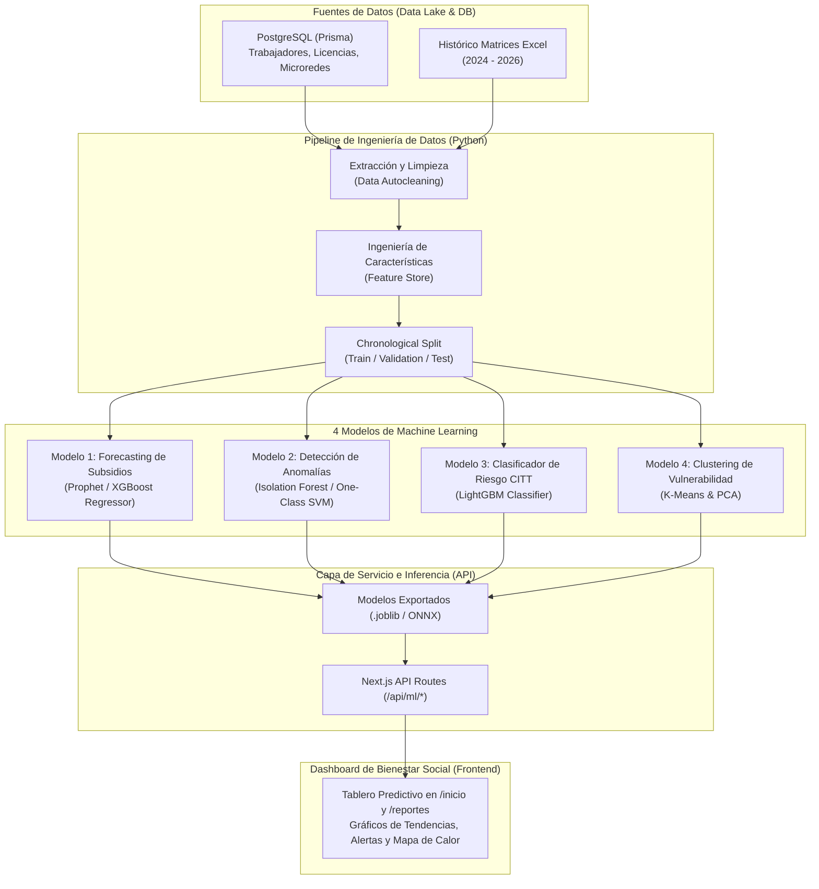

# 🤖 Plan Integral de Machine Learning: Bienestar Social y Gestión de Subsidios
### Red de Salud Huánuco — Dirección Regional de Salud Huánuco (GOREHCO)

---

## 1. Visión y Objetivos Estratégicos

El módulo de Bienestar Social administra las licencias médicas, el régimen de descansos y el recupero de subsidios ante EsSalud para las 13 Microredes y la Sede Central. Actualmente, la plataforma opera de manera reactiva (registra y calcula lo que ya ocurrió).

La integración de **Machine Learning (ML)** transformará el sistema en una **plataforma predictiva, preventiva y de analítica avanzada** con 4 objetivos estratégicos:

1. **Eficiencia Presupuestal**: Anticipar el flujo de días de subsidio y el monto proyectado a recuperar ante EsSalud.
2. **Auditoría Preventiva y Transparencia**: Detectar anomalías y patrones atípicos de ausentismo antes de observaciones de OCI / Contraloría.
3. **Cero Pérdida Económica por Prescripción**: Predecir qué descansos particulares tienen alto riesgo de caducar antes del canje a CITT.
4. **Resiliencia Operativa de Salud**: Identificar qué centros de salud y postas rurales sufrirán desabastecimiento de personal médico por enfermedad.

---

## 2. Mapa de Arquitectura MLOps



---

## 3. Especificación Detallada de los 4 Modelos

### 📈 MODELO 1: Pronóstico de Subsidios y Días de Ausentismo (Time Series Forecasting)

* **Problema de Negocio**: La Red necesita saber con 30 a 90 días de anticipación cuántos días de reposo médico superarán el día 20 (días subsidiados) para planificar el flujo de caja, reemplazos y solicitudes de reembolso ante EsSalud.
* **Tipo de Tarea**: Regresión y Series Temporales multivariadas.
* **Variable Objetivo ($Y$)**: 
  - `total_dias_subsidio_mes`: Cantidad de días acumulados del mes que pasan a EsSalud.
  - `monto_estimado_recupero`: Estimación en Soles del subsidio sujeto a trámite.

#### Ingeniería de Características (Features):
- **Temporales / Calendario**: Mes del año, trimestre, cantidad de días laborables, presencia de feriados largos.
- **Lags (Rezagos temporales)**: Días de subsidio en $t-1$, $t-2$, $t-3$, $t-12$ (mismo mes del año anterior).
- **Medias Móviles (Rolling Windows)**: Media móvil de 3 y 6 meses (`rolling_mean_3m`, `rolling_mean_6m`), desviación estándar móvil.
- **Estacionalidad Sanitaria Local**: Factor climático de Huánuco (temporada de lluvias/heladas en zonas altas como Margos/Chavinillo vs calor/dengue en zonas bajas).
- **Variables Estructurales**: Total de personal activo en el régimen CAS vs Nombrado 276.

#### Modelos y Estrategia de Evaluación:
1. **Baselines**: Promedio histórico del mismo mes y modelo ARIMA/SARIMAX clásico.
2. **Modelos Candidatos**: **Facebook Prophet** con estacionalidades personalizadas y **XGBoost Regressor / LightGBM**.
3. **División de Datos**: Separación cronológica estricta (ej. Entrenamiento: 2024 a Mayo 2026; Prueba: Junio a Septiembre 2026). Sin filtración temporal (*zero leakage*).
4. **Métricas de Éxito**:
   - $\text{MAE}$ (Mean Absolute Error): Error promedio en días.
   - $\text{MAPE}$ (Mean Absolute Percentage Error): Error porcentual menor al 8%.
   - $\text{RMSE}$ (Root Mean Squared Error).

#### Entrega en Pantalla:
- Gráfico de abanico (*confidence bands*) con proyección a 3 meses.
- Estimación económica: *"Se prevé que en Noviembre 2026 habrá 380 días de subsidio (~S/. 28,500 en trámites de recupero ante EsSalud)"*.

---

### 🛡️ MODELO 2: Detección de Anomalías y Certificados Atípicos (Unsupervised Anomaly Detection)

* **Problema de Negocio**: Identificar patrones atípicos de ausentismo médico que puedan constituir irregularidades administrativas o fraude antes de que sean observados por el Órgano de Control Institucional (OCI) o auditores de EsSalud.
* **Tipo de Tarea**: Detección de Outliers y Anomalías (Aprendizaje No Supervisado).
* **Variable Objetivo**: No requiere etiquetas previas. Produce un `Score de Anomalía` de 0.00 a 1.00.

#### Patrones Específicos a Detectar:
1. **Fraccionamiento Estratégico**: Emisión de múltiples descansos particulares cortos (ej: 4 días + 4 días + 4 días) para no alcanzar el día 20 y evitar el trámite de CITT ante EsSalud.
2. **Efecto Fin de Semana / Puente**: Concentración desproporcionada de inicios de descanso en viernes/lunes o vísperas de feriados.
3. **Concentración de Médicos Emisores**: Un solo médico particular emitiendo un volumen inusual de certificados para servidores de una misma posta.
4. **Desviación de Duración**: Licencias cuya duración excede en más de $3\sigma$ la media del diagnóstico o cargo.

#### Características (Features):
- `ratio_particulares_vs_citt`: Porcentaje de certificados que no son de EsSalud.
- `frecuencia_licencias_semestre`: Cantidad de licencias en los últimos 180 días.
- `promedio_dias_entre_licencias`: Intervalo medio entre el fin de una licencia y el inicio de la siguiente.
- `coincidencia_feriados_pct`: Porcentaje de descansos adyacentes a días no laborables.
- `zscore_duracion_cargo`: Desviación de días respecto a su grupo ocupacional.

#### Algoritmos y Validación:
- **Isolation Forest**: Divide el espacio de características mediante árboles aleatorios; las anomalías se aíslan con pocas divisiones.
- **DBSCAN / Local Outlier Factor (LOF)**: Densidad espacial de puntos atípicos.
- **Explicabilidad (XAI)**: Implementación de **TreeSHAP** para que el sistema indique con exactitud qué variables dispararon la alerta (ej: *"Alerta disparada por: 85% certificados particulares y 4 descansos en vísperas de feriado"*).

#### Entrega en Pantalla:
- Pestaña de **"Auditoría Preventiva"** en el panel de Bienestar Social con tarjetas clasificadas en:
  - 🟢 Normal (Score < 0.40)
  - 🟡 Observación Leve (0.40 - 0.70)
  - 🔴 Requiere Verificación de Trabajo Social (> 0.70)

---

### ⏱️ MODELO 3: Clasificador de Riesgo de Caducidad de Canjes CITT (Supervised Classification)

* **Problema de Negocio**: Los certificados médicos particulares prescriben si no se tramitan a tiempo. La Red de Salud Huánuco pierde el dinero del subsidio cuando un descanso no se canjea antes del plazo límite de EsSalud.
* **Tipo de Tarea**: Clasificación Binaria Supervisada.
* **Variable Objetivo ($Y$)**: `canje_retrasado_o_perdido` (1 = Demoró > 30 días o se perdió; 0 = Canjeado a tiempo).

#### Características (Features):
- **Datos Geográficos y Logísticos**: ID de la Microred, distancia y accesibilidad hacia la Sede Central Huánuco (postas ribereñas o altoandinas vs urbanas).
- **Perfil Laboral**: Condición (CAS vs Nombrado), régimen de turnos (guardias vs administrativo).
- **Historial del Servidor**: Tasa histórica de puntualidad en trámites pasados.
- **Magnitud del Descanso**: Cantidad de días otorgados (a mayor cantidad de días, mayor urgencia de canje).
- **Canal de Ingreso**: Registro presencial vs mesa de partes digital.

#### Algoritmos y Métrica de Negocio:
1. **Modelos**: Regresión Logística con regularización ElasticNet (Baseline) vs **Random Forest** vs **LightGBM Classifier**.
2. **Desbalance de Clases**: Aplicación de técnicas como ponderación de pesos de clase (`scale_pos_weight`) o submuestreo controlado.
3. **Métrica Clave**: **Recall / F1-Score en la clase positiva** (en este problema de negocio, un *Falso Negativo* significa perder dinero de subsidio, por lo que priorizamos capturar la mayor cantidad de riesgos posibles sin falsas alarmas excesivas).

#### Entrega en Pantalla:
- En la tabla de licencias de `/salud` y en el semáforo de `/inicio`, una insignia de **Riesgo Predictivo**:
  - *"Riesgo de Caducidad: 82% (Alto). Causa: Microred remota y descanso superior a 15 días. Acción: Generar oficio de requerimiento automático al jefe de posta."*

---

### 🗺️ MODELO 4: Segmentación de Vulnerabilidad y Ausentismo por Microred (Clustering)

* **Problema de Negocio**: Recursos Humanos debe distribuir reemplazos y presupuestos de suplencia médica de forma justa y científica entre las 13 Microredes.
* **Tipo de Tarea**: Aprendizaje No Supervisado (Clustering).
* **Objetivo**: Agrupar los centros de salud y postas en conglomerados homogéneos según su patrón de riesgo de bajas médicas.

#### Características por Establecimiento:
- `tasa_ausentismo_anual`: Total días de reposo médico dividido entre el total de personal asignado.
- `ausentismo_personal_critico`: Días de reposo específicamente en médicos y obstetras (puestos irreemplazables).
- `duracion_promedio_licencia`: Días medios por expediente.
- `ratio_subsidios_acumulados`: Porcentaje de trabajadores que pasaron los 20 días de empleador.
- `estacionalidad_amplitud`: Diferencia entre el mes de mayor ausentismo y el de menor ausentismo.

#### Algoritmos y Validación Técnica:
1. **Normalización**: `StandardScaler` en todas las variables continuas.
2. **Determinación del $k$ Óptimo**:
   - Análisis de **Silhouette Score** (coeficiente de silueta para evaluar cohesión y separación).
   - Método del Codo (*Elbow Method* con WCSS).
3. **Algoritmos**: **K-Means Clustering** y **Clustering Jerárquico Aglomerativo**.
4. **Visualización**: Reducción de dimensiones con **PCA** (Análisis de Componentes Principales) o **t-SNE** a 2 dimensiones para el mapa de dispersión.

#### Definición de Clusters Resultantes:
- **Cluster A (Verde - Estable)**: Postas con ausentismo bajo, personal suficiente y bajo impacto en atenciones.
- **Cluster B (Amarillo - Vulnerabilidad Estacional)**: Postas con picos marcados en ciertas épocas del año (ej: heladas). Requiere refuerzo programado.
- **Cluster C (Rojo - Zona Crítica de Alto Riesgo)**: Establecimientos con alto ausentismo de médicos/enfermeros y licencias largas. Requiere presupuesto prioritario para contratos de reemplazo inmediato.

---

## 4. Pipeline Técnico de Implementación (Stack & MLOps)

```
bienestar-social-salud/
├── ml_engine/                      # Módulo de Inteligencia de Datos (Python)
│   ├── data/                       # Datasets extraídos y limpios
│   ├── notebooks/                  # Análisis exploratorio (EDA) y validación
│   ├── src/
│   │   ├── preprocess.py           # Limpieza, codificación y feature store
│   │   ├── train_forecasting.py    # Entrenamiento Modelo 1 (Subsidios)
│   │   ├── train_anomalies.py      # Entrenamiento Modelo 2 (Anomalías)
│   │   ├── train_caducidad.py      # Entrenamiento Modelo 3 (Riesgo CITT)
│   │   └── train_clustering.py     # Entrenamiento Modelo 4 (Microredes)
│   └── models/                     # Modelos serializados (.joblib / .onnx)
│       ├── model_forecasting.joblib
│       ├── model_anomalies.joblib
│       ├── model_citt_risk.joblib
│       └── model_clusters.joblib
└── src/app/api/ml/                 # Endpoints Backend en Next.js
    ├── forecasting/route.ts        # GET: Predicciones de subsidios
    ├── anomalias/route.ts          # GET: Expedientes con banderas rojas
    ├── riesgo-citt/route.ts        # POST: Score de riesgo de un CITT
    └── clusters/route.ts           # GET: Segmentación de microredes
```

---

## 5. Cronograma de Ejecución por Fases

| Fase | Duración Estimada | Entregables Clave |
| :--- | :--- | :--- |
| **Fase 1: Preparación de Datos (EDA)** | Semana 1 | Extracción de BD PostgreSQL + unión con `LICENCIAS BIENESTAR 2026-DIOMI.xlsx`. Análisis de nulos y distribuciones. |
| **Fase 2: Modelos Core (1 y 2)** | Semana 2 | Entrenamiento de Modelo 1 (Pronóstico de Subsidios) y Modelo 2 (Detección de Anomalías). Validación cruzada y métricas. |
| **Fase 3: Modelos Complementarios (3 y 4)** | Semana 3 | Entrenamiento de Modelo 3 (Riesgo CITT) y Modelo 4 (Clustering de Microredes). Serialización a `.joblib`. |
| **Fase 4: Endpoints API & Conexión** | Semana 4 | Creación de endpoints `/api/ml/*` y conexión con la base de datos de producción. |
| **Fase 5: Dashboard Visual (UI)** | Semana 5 | Pantalla de **"Analítica Predictiva"** en Next.js con gráficos de líneas, semáforos ML y mapas de calor. |

---

## 6. Conclusión y Valor Institucional

La implementación de este plan posicionará a la **Red de Salud Huánuco** como referente de innovación tecnológica y modernización en la gestión pública:
- **Transparencia Total**: Los algoritmos matemáticos justifican de manera imparcial y técnica las decisiones de control interno y dotación de personal.
- **Recuperación Máxima de Fondos**: Se reduce a casi cero la pérdida de subsidios por vencimiento de plazos ante EsSalud.
- **Garantía en Salud Pública**: Las microredes en situación crítica por ausentismo médico recibirán alertas tempranas para que ningún ciudadano se quede sin atención.
