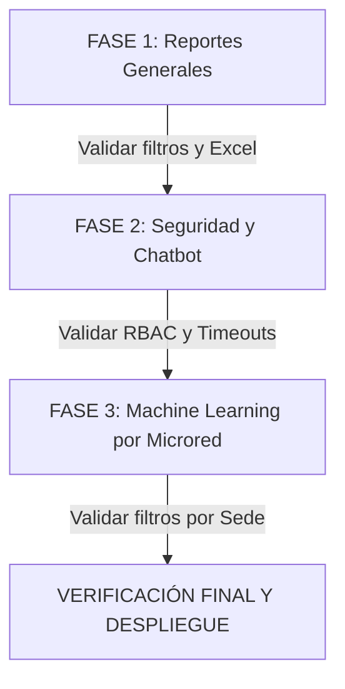

# 📋 PLAN MAESTRO DE ANÁLISIS, GESTIÓN Y MEJORAS TÉCNICAS
## Módulo de Bienestar Social y Salud — Red de Salud Huánuco

> **Fecha de Elaboración:** Octubre 2026  
> **Objetivo:** Planificar de forma estructurada, fase por fase, las soluciones a los requerimientos de Reportes Generales (PDF y Excel Masivo), Seguridad/Jurisdicción del Chatbot BienestarBot y Segmentación por Microred en los Modelos de Machine Learning.

---

## 📌 ÍNDICE GENERAL
1. [Diagnóstico de Situación Actual y Hallazgos](#1-diagnóstico-de-situación-actual-y-hallazgos)
2. [Fase 1: Módulo de Reportes Generales (Filtro por Rango de Meses, Condición Laboral y Excel Masivo)](#fase-1-módulo-de-reportes-generales)
3. [Fase 2: Chatbot BienestarBot (Seguridad RBAC por Microred, Identidad de Sesión y Resiliencia sin Timeouts)](#fase-2-chatbot-bienestarbot)
4. [Fase 3: Inteligencia Analítica y Machine Learning Segmentado por Microred](#fase-3-machine-learning-por-microred)
5. [Cronograma y Secuencia de Ejecución Gradual](#5-cronograma-y-secuencia-de-ejecución-gradual)

---

## 1. DIAGNÓSTICO DE SITUACIÓN ACTUAL Y HALLAZGOS

Tras analizar detalladamente los archivos del proyecto, las capturas enviadas y la base de datos PostgreSQL, se identificaron los siguientes puntos críticos:

### A. Reportes e Inteligencia Analítica (`/reportes`):
* **Filtro de Meses Restringido:** Actualmente solo permite elegir **un único mes** a la vez (`mes = 10`), impidiendo generar consolidados bimestrales, trimestrales o anuales continuos.
* **Condiciones Laborales Incompletas:** El dropdown solo muestra en duro `CAS` y `NOMBRADO`. No incluye la opción fundamental **`-- TODOS --`**, ni considera otras modalidades presentes en el padrón como `CAS DIRESA` o contratados por suplencia/plazo fijo.
* **Falta de Exportación a Excel:** La pantalla solo cuenta con el botón *"Generar Vista Previa"* para imprimir el informe en PDF A4. No tiene un botón directo para descargar el **Reporte Masivo de Excel** con todas las hojas por Microred y el desglose de subsidios.

### B. Chatbot Institucional (`BienestarBot` / `/api/chat`):
* **Fuga de Jurisdicción por Búsqueda Difusa:** Al escribir *"hola, ayudame dime a que red pertenezco ?"*, el sistema extrajo la palabra `"red"` y ejecutó una búsqueda abierta en toda la base de datos sin filtrar por la microred del usuario. Terminó devolviendo a un trabajador de la `SEDE RED SALUD HUANUCO` a un administrador de la microred `CAYRÁN`.
* **Desconocimiento de la Sesión del Usuario:** El bot no verifica si el usuario pregunta por su propio perfil administrativo (`session.user.microredId` / `session.user.rol`) para contestarle de inmediato a qué sede o microred pertenece su cuenta.
* **Timeouts en Llamadas a la IA (8 segundos):** En `/api/chat/route.ts`, el `AbortSignal.timeout(8000)` aborta antes de que la API de Gemini complete la respuesta en conexiones móviles o de red institucional, disparando los errores:
  ```text
  Error llamando a modelo chat gemini-3.1-flash-lite: The operation was aborted due to timeout
  Error llamando a modelo chat gemini-flash-lite-latest: The operation was aborted due to timeout
  ```
  Al fallar todos por tiempo, se activa el motor de contingencia offline.

### C. Dashboard de Machine Learning (`/reportes?tab=ml`):
* **Modelos Centralizados sin Filtro Local:** El archivo `ml_insights.json` ya clasifica los casos por microred, pero en la interfaz se muestran los casos atípicos globales (ej. *Santa María del Valle*, *Sede Central*) mezclados.
* **Falta de Vista Específica para Administradores de Sede:** Un gestor de la microred Cayrán necesita ver las predicciones, ausentismo y servidores en riesgo de CITT **exclusivamente de su microred**, mientras que el Super Administrador debe poder ver tanto el consolidado global como el de cada microred individualmente.

---

## 2. FASE 1: MÓDULO DE REPORTES GENERALES
**Archivos involucrados:**
* `src/app/(dashboard)/reportes/page.tsx`
* `src/shared/components/ReporteMensualTemplate.tsx`
* `src/app/api/salud/excel-masivo/route.ts`

### 2.1. Mejoras en la Barra de Filtros:
1. **Selector de Rango de Meses:**
   * Permitir dos modalidades intuitivas:
     * **Modo A (Rango de Meses):** Selector `Mes Desde` (ej. Enero) y `Mes Hasta` (ej. Octubre).
     * **Opción rápida:** Botón para *"Todo el Año"* o *"Mes Específico"*.
   * Parámetro `Año` (2026, editable).
2. **Selector Dinámico de Condición Laboral:**
   * Opción predeterminada: **`-- TODOS --`** (incluye CAS, Nombrados y CAS DIRESA en un solo reporte unificado).
   * Opciones individuales: `CAS`, `NOMBRADO`, `CAS DIRESA` (cargadas dinámicamente desde el padrón).
3. **Acciones Duales (PDF y Excel):**
   * Botón 1: **📄 Generar Informe Mensual (PDF)** → Despliega la vista previa en hoja A4 lista para imprimir o guardar en PDF.
   * Botón 2: **📊 Descargar Reporte Masivo (Excel)** → Descarga inmediatamente el archivo `.xlsx` estructurado por pestañas de Microred con los mismos filtros aplicados.

### 2.2. Consistencia en el Cálculo de Subsidios:
* Asegurar que el reporte muestre toda la información:
  * N° CITT / CMP del médico.
  * Días otorgados, días asumidos por la Red (primeros 20 días en el año) y días netos de subsidio EsSalud (día 21 en adelante).
  * Segmentación por Microredes omitiendo pestañas o bloques vacíos.

---

## 3. FASE 2: CHATBOT BIENESTARBOT
**Archivos involucrados:**
* `src/app/api/chat/route.ts`
* `src/app/api/auth/[...nextauth]/route.ts`
* `src/shared/components/ChatbotAsistente.tsx`

### 3.1. Reconocimiento de Identidad y Pertenencia a Microred:
1. En `src/app/api/auth/[...nextauth]/route.ts`:
   * Al autenticar el usuario, incluir en la sesión el nombre legible de su microred:
     ```ts
     microredNombre: user.microred?.nombre || 'SEDE CENTRAL'
     ```
2. En `src/app/api/chat/route.ts`:
   * Si el usuario escribe preguntas de identidad como *"¿a qué red pertenezco?"*, *"¿cuál es mi microred?"*, *"¿qué cuenta tengo?"*:
     * El bot responderá con precisión:
       > *"Hola **[Nombre]**. Tu cuenta institucional tiene el rol de **Administrador de Sede** asignado a la **Microred Cayrán**. Tu jurisdicción abarca los establecimientos y el personal de dicha microred."*
     * Se evita que palabras comunes como `"red"`, `"pertenezco"` o `"ayudame"` activen consultas no deseadas en la base de datos de trabajadores.

### 3.2. Aislamiento Estricto por Jurisdicción (RBAC):
* Cuando un usuario con rol `SEDE_ADMIN` o gestor consulte por un trabajador (por DNI o por nombre):
  * La consulta SQL en Prisma se filtrará **obligatoriamente** por su `userMicroredId`:
    ```ts
    where: {
      ...criterioBusqueda,
      establecimiento: { microredId: Number(userMicroredId) }
    }
    ```
  * Si el trabajador pertenece a otra microred (ej. Sede Central o Santa María del Valle), el bot responderá cordialmente:
    > *"El servidor no pertenece a la Microred Cayrán (tu jurisdicción asignada). Por normativas de confidencialidad, no es posible acceder a expedientes fuera de tu microred."*
* Si el rol es `SUPER_ADMIN`, mantiene acceso irrestricto a todas las microredes.

### 3.3. Solución a los Timeouts de la API de IA (Gemini):
* **Ampliación de Timeout:** Aumentar el tiempo límite de espera de `8000ms` a `22000ms` (22 segundos), igual que en el escáner CITT.
* **Rotación y Backoff:** Implementar un fallback ordenado que intente primero los modelos más rápidos y estables (`gemini-2.5-flash`, `gemini-1.5-flash`), y solo si todos fallan o no hay internet, active el generador conversacional offline garantizado sin errores.

---

## 4. FASE 3: MACHINE LEARNING POR MICRORED
**Archivos involucrados:**
* `src/shared/components/MLDashboardCard.tsx`
* `src/app/api/ml/route.ts`
* `ml_engine/output/ml_insights.json`

### 4.1. ¿Es posible segmentar el Machine Learning por Microred?
**Respuesta:** **Sí, es 100% posible y viable**.
El motor de Machine Learning (`ml_engine`) ya etiqueta cada registro con su respectiva `"microred"` (ej. `"MICRO RED CAYRAN"`, `"SEDE RED SALUD HUANUCO"`). No requiere reescribir los algoritmos de Python desde cero, sino habilitar la **capa de segmentación y filtrado inteligente**:

1. **Selector de Microred en el Dashboard de ML:**
   * Si es `SUPER_ADMIN`: Puede ver el análisis de *"Todas las Microredes (Consolidado Red Huánuco)"* o desplegar el combo y filtrar por *"Microred Cayrán"*, *"Microred Churubamba"*, etc.
   * Si es `SEDE_ADMIN`: El sistema detecta su microred en la sesión y bloquea la vista automáticamente a **su propia microred**, mostrando:
     * **Casos Atípicos (Anomalías):** Servidores únicamente de su microred con ausentismo elevado.
     * **Certificados en Riesgo (Semáforo 30 días):** Descansos particulares de sus propios centros de salud que están por vencer.
     * **Estadísticas de Canje:** Porcentaje de certificados EsSalud vs Particulares de sus establecimientos.
     * **Proyecciones de Días de Subsidio:** Estimación local para su jurisdicción.

---

## 5. CRONOGRAMA Y SECUENCIA DE EJECUCIÓN GRADUAL



### Paso 1: Módulo de Reportes Generales
1. Implementar selector de rango de meses (`Mes Desde` / `Mes Hasta`) y año en `reportes/page.tsx`.
2. Habilitar la condición laboral `-- TODOS --` y opciones dinámicas (`CAS`, `NOMBRADO`, `CAS DIRESA`).
3. Incorporar el botón de descarga directa de **Excel Masivo**.
4. Validar visualización en el visor A4 y exportación contable.

### Paso 2: Seguridad, RBAC y Estabilidad del Chatbot
1. Enriquecer `authOptions` con `microredNombre`.
2. Actualizar `api/chat/route.ts` para reconocer la identidad de la cuenta y responder a qué microred pertenece.
3. Aplicar filtro estricto `microredId` en todas las consultas de trabajadores realizadas por administradores de sede.
4. Incrementar timeout de Gemini a 22s y optimizar lista de modelos para erradicar las caídas por timeout.

### Paso 3: Segmentación por Microred en Machine Learning (COMPLETADO)
1. Agregar el selector de Microred en `MLDashboardCard.tsx` (con estilo Apple y selector para SUPER_ADMIN / bloqueo automático para SEDE_ADMIN).
2. Adaptar el estado y filtros de las 5 pestañas de modelos (Pronóstico Presupuestal, Casos Atípicos, Semáforo CITT 30 días, Reducción PCA/Clustering, Origen EsSalud vs Particular).
3. Asegurar que los administradores de sede vean automáticamente la información de su propia microred tanto en API (`/api/ml`) como en la interfaz gráfica.
4. Validado con compilación TypeScript `0 errores`.
